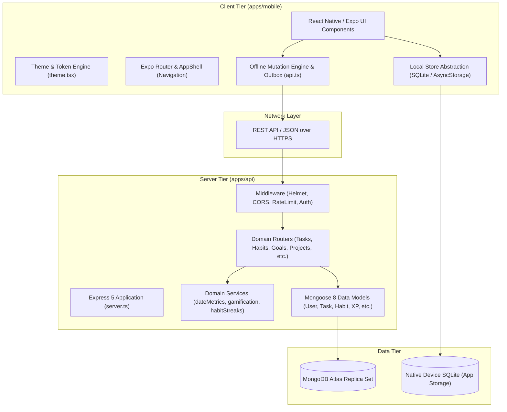
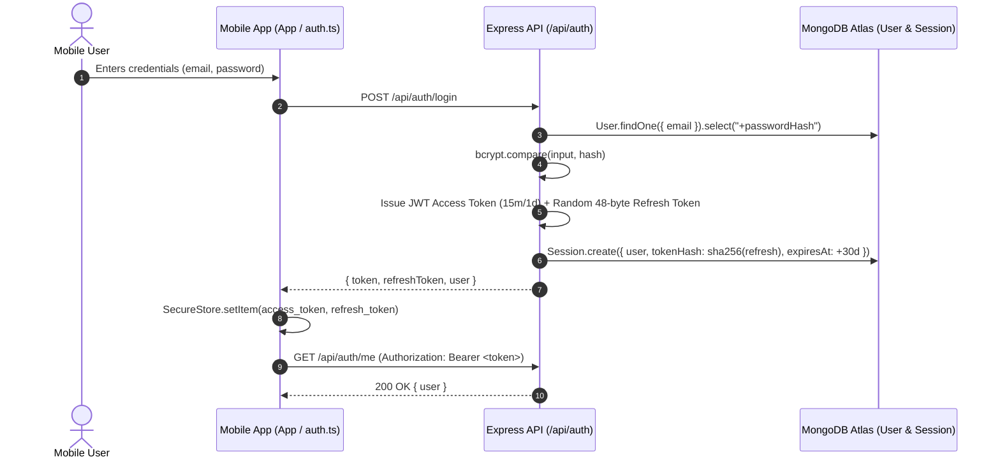
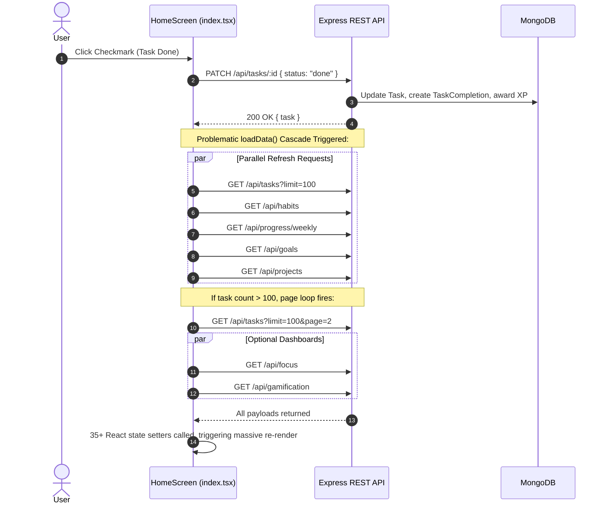
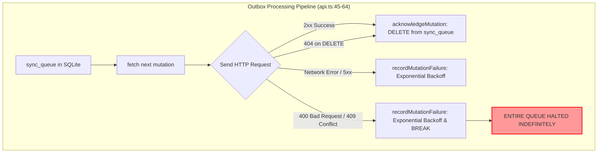
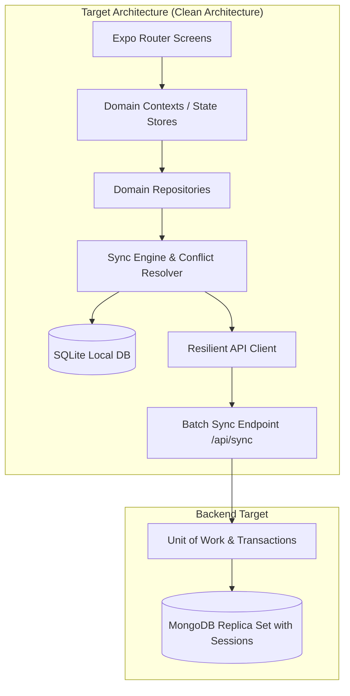

# Comprehensive Architecture & System Design Analysis

**Document:** `PROJECT_ANALYSIS/ARCHITECTURE_ANALYSIS.md`  
**Target System:** Hyper Track (Monorepo)  
**Evaluator:** Principal Enterprise Architect & Senior Technical Lead  

---

## 1. System Context & High-Level Architecture

Hyper Track is built as an npm workspace monorepo dividing responsibilities between client rendering, REST API services, and shared contracts.



---

## 2. Technology Stack Evaluation

| Layer | Selected Technology | Version in Use | Evaluation & Suitability Assessment |
| :--- | :--- | :--- | :--- |
| **Mobile Runtime** | React Native / Expo | Expo `~58.0.22`, RN `0.88.1` | **Modern & Capable.** Expo SDK 58 with New Architecture enabled (`newArchEnabled: true` in `app.json`) provides strong cross-platform support. |
| **Routing** | Expo Router | `~58.0.29` | **Underutilized.** While Expo Router is installed with file-based routing (`app/_layout.tsx`, `app/index.tsx`), the application is architectured as a monolithic single-screen app with internal state tab switching (`tab === "tasks" ? ... : tab === "habits" ? ...`). True URL/deep-linking and sub-routes are not leveraged. |
| **Client Storage** | Expo SQLite & AsyncStorage | SQLite `~58.0.15`, AsyncStorage `2.2.0` | **Fragmented Hybrid.** Native builds utilize SQLite, but web falls back to AsyncStorage. The synchronization logic bridges both, creating dual persistence logic paths. |
| **Backend Runtime** | Node.js + TypeScript | Node 22 / TS 5.9 | **Industry Standard.** Express 5 brings built-in async error delegation; `tsx` is used for fast ESM execution in development. |
| **Database & ODM** | MongoDB + Mongoose | Mongoose `^8.18.0` | **Mixed Fit.** Document storage is appropriate for task/habit metadata, but relational requirements (projects -> tasks -> subtasks, goals -> milestones, foreign key integrity) require extensive manual application-level referential checks. |
| **Auth & Security** | JWT + bcryptjs | JWT `^9.0.2`, bcrypt `^3.0.2` | **Standard.** 12-round bcrypt password hashing with SHA-256 hashed refresh tokens stored in MongoDB with TTL indexing. Access tokens are stateless. |
| **Validation** | Zod | `^4.1.5` | **Excellent.** Synchronized type inference across frontend and backend boundaries. |

---

## 3. Monorepo Organization & Module Boundaries

The project structure contains three primary packages:

```
hyper-track/
├── apps/
│   ├── api/          # Express REST API (Node.js/TypeScript)
│   └── mobile/       # Expo / React Native client (Android/iOS/Web)
├── packages/
│   └── shared/       # Shared TypeScript interfaces and DTOs
├── scripts/          # Workspace management scripts (clean.mjs, dev.mjs)
└── .github/          # CI/CD Workflows
```

### Module Boundary Analysis:
1. **Shared DTOs (`packages/shared/src/index.ts`):**
   - Exports data transfer object types (`TaskDTO`, `HabitDTO`, `GoalDTO`, `ProjectDTO`, `AuthUserDTO`).
   - **Weakness:** It only shares raw interfaces. It does not share Zod validation schemas. Validation schemas are duplicated between `apps/api/src/routes/*.ts` and client-side form validation, leading to drift (e.g., date formats, length limits).
2. **Coupling between Mobile and API:**
   - The mobile application hardcodes API endpoints directly in UI screens instead of consuming a client SDK generated from the shared package or OpenAPI specs.

---

## 4. End-to-End Data Flow Architecture

### 4.1 Authentication & Session Lifecycle



**Architectural Flaws in Auth Flow:**
1. **No Token Revocation for Access Tokens:** Access tokens are stateless JWTs. When a user logs out (`POST /api/auth/logout`), the API deletes all sessions from MongoDB (`Session.deleteMany({ user: req.userId })`), but the currently active access token remains valid until it expires.
2. **Mass Session Eviction:** `POST /api/auth/logout` executes `Session.deleteMany({ user: req.userId })` at `apps/api/src/routes/auth.routes.ts:107`, which logs the user out of **all** devices simultaneously, instead of invalidating only the current device's refresh token.

---

### 4.2 Data Fetching & Cascading Reload Flow

When the mobile app performs any mutation (e.g., ticking a task complete), it executes the following waterfall:



---

## 5. Offline-First Architecture & Outbox Queue Review

The mobile offline architecture (`apps/mobile/src/lib/api.ts`, `localStore.native.ts`, `offlineMutations.ts`) was implemented as an additive SQLite layer.

### How it currently operates:
1. **Optimistic Mutations:** When a write occurs while offline, `cacheOfflineCreate` or `applyOfflineMutation` assigns a client-generated 24-character hexadecimal ObjectId (`createLocalObjectId`), appends the entity to the cached response payload, and enqueues a mutation row into `sync_queue` table in SQLite.
2. **FIFO Outbox Replay:** `flushPendingMutations` reads ready rows from `sync_queue` and replays them over HTTP to the API.
3. **Queue Policy:** `readyQueuePrefix` (`queuePolicy.ts:4-10`) enforces that mutations are executed in strict FIFO order to maintain dependencies (e.g., task creation must succeed before updating its status to "done").



### Critical Architectural Vulnerabilities in Offline Engine:
1. **The Poison Pill Deadlock (`apps/mobile/src/lib/api.ts:50-53`):**
   ```ts
   if (!response.ok && !(response.status === 404 && item.method === "DELETE")) {
     await recordMutationFailure(item.id, item.attempts + 1, `HTTP ${response.status}`);
     // Keep FIFO dependencies intact: later edits may depend on this create.
     break;
   }
   ```
   If a request fails with an unrecoverable HTTP 400 (e.g., validation constraint failure, field too long, duplicate clientMutationId collision), the loop calls `recordMutationFailure` and **breaks**. Because it is a 4xx client error, retrying will NEVER succeed. Because `readyQueuePrefix` will not execute subsequent items while an earlier item is pending, **the entire synchronization queue is permanently frozen**.
2. **Missing Backend Synchronization Protocol:**
   The backend lacks an incremental sync endpoint (`/api/sync`), entity revision numbers/ETags, and deletion tombstones. If a task is modified on another device, the local offline client will blindly overwrite it upon reconnecting.

---

## 6. Structural & Architectural Weaknesses

1. **Absence of Domain Repositories on Client:**
   In `apps/mobile/app/index.tsx`, UI components make direct calls to the raw `api(...)` helper instead of feature repositories (e.g., `TaskRepository`, `HabitRepository`).
2. **Dual-Model Duplication in Habits:**
   In `apps/api/src/models/Habit.ts`, the model maintains `completions: [String]` (an array of date strings on the habit document itself), while simultaneously maintaining a collection of `HabitCompletion` documents (`apps/api/src/models/HabitCompletion.ts`). Writing to two separate representations without a database transaction causes divergence.
3. **Pseudo-Relational Cascade Archival Flaws:**
   In `apps/api/src/routes/projects.routes.ts:49`, archiving a project sets `project: null` on all member tasks (`Task.updateMany({ user: req.userId, project: project._id }, { $set: { project: null } })`). If the user later unarchives/reopens the project, the relational linkage is permanently destroyed and cannot be restored.

---

## 7. Recommended Architectural Target State



1. **Migrate to Domain Contexts:** Refactor `index.tsx` into modular React Contexts (`AuthContext`, `TaskContext`, `HabitContext`, `ProjectContext`).
2. **Introduce Dead-Letter Queue (DLQ):** Separate non-retryable 4xx mutation errors from 5xx/network transient errors, allowing users to inspect, edit, or discard failed offline writes.
3. **Database Transactions:** Wrap all multi-document operations (`Task` + `TaskCompletion` + `XPTransaction`) in MongoDB transactions via `mongoose.startSession()`.

