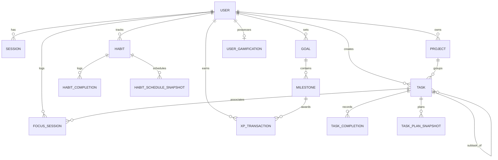

# Database Architecture, Schema Integrity & Query Performance Analysis

**Document:** `PROJECT_ANALYSIS/DATABASE_ANALYSIS.md`  
**Database Engines:** MongoDB Atlas 8.x (Primary Cloud Datastore) & SQLite 3 (Client Offline Store)  
**Evaluator:** Principal Database Architect & Data Systems Engineer  

---

## 1. Data Model & Schema Overview

Hyper Track utilizes an event-informed document model in MongoDB with complementary normalized SQLite tables on native mobile devices.



---

## 2. Comprehensive Model & Index Inventory

| Model | Collection / Table | Purpose & Nature | Primary Keys / Indexes | Integrity / Index Rating |
| :--- | :--- | :--- | :--- | :--- |
| **`User`** | `users` | Account identity, password hash, timezone | `email: 1` (Unique) | **Good.** Trimmed, lowercase transformed. |
| **`Session`** | `sessions` | Refresh token sessions | `tokenHash: 1` (Unique), `expiresAt: 1` (TTL: `expireAfterSeconds: 0`) | **Excellent.** Automatic TTL cleanup. |
| **`Task`** | `tasks` | Actionable work items | `{ user: 1, createdAt: -1 }`<br>`{ user: 1, dueDate: 1, status: 1 }`<br>`{ user: 1, plannedDate: 1, status: 1 }`<br>`{ user: 1, project: 1, status: 1 }`<br>`{ user: 1, parentTask: 1, status: 1 }`<br>`{ user: 1, clientMutationId: 1 }` (Unique, partial) | **High Quality.** Proper compound indexes covering dashboard and task list filters. |
| **`TaskCompletion`** | `taskcompletions` | Immutable task completion facts | `{ user: 1, task: 1, completedAt: -1 }`<br>`{ user: 1, localDate: 1 }` | **Deficient.** Queries regularly filter `{ user, localDate: { $gte, $lte }, reversedAt: null }`. Missing compound index on `{ user: 1, reversedAt: 1, localDate: 1 }`. |
| **`TaskPlanSnapshot`**| `taskplansnapshots` | Append-only planned date audit trail | `{ user: 1, plannedDate: 1 }`<br>`{ user: 1, task: 1, assignedAt: -1 }` | **Good.** Supports historical calendar planning replay. |
| **`Habit`** | `habits` | Behavioral habits & schedules | `{ user: 1, createdAt: -1 }`<br>`{ user: 1, name: 1 }`<br>`{ user: 1, clientMutationId: 1 }` (Unique, partial) | **Flawed.** Denormalizes `completions: [String]` directly on the document, creating split-brain divergence with `HabitCompletion`. |
| **`HabitCompletion`** | `habitcompletions` | Habit daily check-in facts | `{ user: 1, habit: 1, localDate: 1 }` (**Strict Unique**)<br>`{ user: 1, localDate: 1 }` | **CRITICAL DEFECT.** Unique index forbids re-completing a previously reversed habit on the same day. |
| **`HabitScheduleSnapshot`** | `habitschedulesnapshots` | Historical schedule intervals | `{ user: 1, validFromAt: 1, validToAt: 1 }`<br>`{ user: 1, habit: 1, validFromAt: -1 }` | **Good.** Enables schedule-accurate historical streak calculations. |
| **`Project`** | `projects` | High-level work grouping | `{ user: 1, status: 1, createdAt: -1 }`<br>`{ user: 1, clientMutationId: 1 }` (Unique, partial) | **Acceptable.** Archival logic contains data-loss bug. |
| **`Goal`** | `goals` | Long-term target outcomes | `{ user: 1, status: 1, targetDate: 1 }`<br>`{ user: 1, clientMutationId: 1 }` (Unique, partial) | **Good.** Milestones embedded as subdocuments. |
| **`FocusSession`** | `focussessions` | Pomodoro focus sessions | `{ user: 1, startedAt: -1 }`<br>`{ user: 1, status: 1 }`<br>`{ user: 1, clientMutationId: 1 }` (Unique, partial) | **Good.** |
| **`UserGamification`** | `usergamifications` | User XP totals | `{ user: 1 }` (Unique) | **Vulnerable.** Updates bypass schema validation; `totalXp` can become negative. |
| **`XPTransaction`** | `xptransactions` | Immutable XP ledger | `eventKey: 1` (Unique)<br>`{ user: 1, localDate: 1 }` | **Good.** Strictly prevents duplicate awards for identical event keys. |

---

## 3. Critical Database Defects & Data Inconsistency Scenarios

### 3.1 The HabitCompletion Re-Checkin Conflict (DATA-01)
- **Location:** `apps/api/src/models/HabitCompletion.ts:14`
- **Schema Code:**
  ```ts
  habitCompletionSchema.index({ user: 1, habit: 1, localDate: 1 }, { unique: true });
  ```
- **The Failure Sequence:**
  1. User checks in Habit A for today (`2026-11-04`).
  2. Document inserted: `{ user: U1, habit: H1, localDate: "2026-11-04", reversedAt: null }`.
  3. User realizes it was a mistake and unchecks it.
  4. Endpoint `DELETE /api/habits/:id/completions/:date` sets `reversedAt: 2026-11-04T01:50:00Z`. The record is **soft-deleted / reversed**, but remains in MongoDB.
  5. User later completes the habit for real in the evening.
  6. Endpoint `POST /api/habits/:id/completions` attempts `HabitCompletion.create(...)`.
  7. **MongoDB throws Error E11000 duplicate key error on `{ user: 1, habit: 1, localDate: 1 }`**.
  8. Global error middleware maps Error 11000 to `"An account with this email already exists"`.
- **Remediation:**  
  Change the unique index to a partial index that only enforces uniqueness for active (non-reversed) check-ins:
  ```ts
  habitCompletionSchema.index(
    { user: 1, habit: 1, localDate: 1 },
    { unique: true, partialFilterExpression: { reversedAt: null } }
  );
  ```

---

### 3.2 Data Loss on Project Deletion / Reopen (DATA-02)
- **Location:** `apps/api/src/routes/projects.routes.ts:47-49`
- **Code:**
  ```ts
  const project = await Project.findOneAndUpdate(
    { _id: req.params.id, user: req.userId, archivedAt: null },
    { $set: { archivedAt: new Date() } },
    { new: true }
  );
  if (!project) { res.status(404).json({ error: "Project not found" }); return; }
  await Task.updateMany({ user: req.userId, project: project._id }, { $set: { project: null } });
  ```
- **The Problem:**  
  When a project is archived, the backend actively overwrites all associated tasks by setting `project: null`. If the user later unarchives or reopens the project, **the association is permanently gone**. The tasks cannot be restored to the project because their foreign key was set to `null` rather than using a soft-delete status.
- **Remediation:**  
  Do not overwrite `project` with `null`. When querying active tasks, filter by active projects or allow tasks to retain their `project` identifier while the project itself has `archivedAt != null`.

---

### 3.3 Unbounded In-Memory Streaks & Heap Exhaustion (DATA-03)
- **Location:** `apps/api/src/routes/gamification.routes.ts:18-20`
- **Code:**
  ```ts
  const [game, taskEvents, habitEvents, transactions, user] = await Promise.all([
    UserGamification.findOne({ user: req.userId }).lean(),
    TaskCompletion.find({ user: req.userId }).select("localDate reversedAt").lean(),
    HabitCompletion.find({ user: req.userId }).select("localDate reversedAt").lean(),
    XPTransaction.find({ user: req.userId }).sort({ createdAt: -1 }).limit(30)...
  ]);
  ```
- **The Problem:**  
  On every single dashboard load, the API executes an unpaginated `find` retrieving **every single task and habit completion document ever recorded** for that user across years of usage. It pulls them into Node.js heap memory to calculate consecutive day streaks using JavaScript loops (`dateMetrics.ts:longestConsecutive`).
- **Scalability Limit:**  
  A power user with 20 tasks/day over 2 years generates ~15,000 documents. Running this in memory on every dashboard visit will quickly trigger V8 garbage collection spikes and high latency.
- **Remediation:**  
  Compute daily activity rollups (e.g., in a `DailyProgress` summary collection updated upon check-in) or execute an optimized MongoDB aggregation pipeline with `$dateTrunc` and `$group`.

---

## 4. Suitability Evaluation of MongoDB

| Architectural Requirement | MongoDB Fit | Analysis |
| :--- | :---: | :--- |
| **Dynamic Form Attributes** | **Excellent** | Task recurrence, habit schedules, and flexible milestones benefit from document schema flexibility. |
| **Referential Integrity** | **Poor** | The application requires strict parent-child hierarchies (Projects -> Tasks -> Subtasks, Goals -> Milestones). MongoDB does not enforce foreign keys; all constraints must be verified with sequential `exists()` calls, introducing race conditions. |
| **Audit Trails & Events** | **Good** | Append-only event collections (`TaskCompletion`, `XPTransaction`, `TaskPlanSnapshot`) map cleanly to MongoDB's high-write-throughput capabilities. |
| **Transaction Complexity** | **Moderate** | Multi-document transactions require replica set sessions. The current codebase uses zero transactions, resulting in partial-write anomalies. |

**Verdict:** MongoDB is acceptable provided replica set transactions (`mongoose.startSession()`) are introduced for atomic multi-document mutations. A relational database (PostgreSQL with JSONB) would have naturally solved referential integrity and foreign-key cascades, but migrating away from MongoDB is unnecessary if MongoDB transactions are properly implemented.

---

## 5. Backup, Recovery & Migration Strategy

1. **Current State:**  
   No automated backup configuration exists in code or documentation. The application relies entirely on the external host's default snapshot policy.
2. **Missing Migration Tooling:**  
   Schema changes are currently applied via ad-hoc standalone scripts (e.g. `apps/api/src/scripts/backfill-completion-events.ts`). There is no versioned migration framework (such as `migrate-mongo` or `umzug`).
3. **Recommended Production Strategy:**
   - **Continuous Backups:** Enable MongoDB Atlas Point-in-Time Recovery (PITR) with continuous oplog backups.
   - **Migration Framework:** Introduce `migrate-mongo` to track applied schema patches in a `migrations` metadata collection.
   - **Pre-Deployment Checks:** Verify unique partial indexes are built in the background (`{ background: true }`) before routing production traffic.

