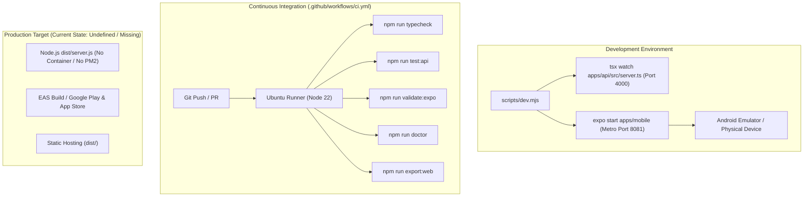

# DevOps, CI/CD & Deployment Architecture Audit

**Document:** `PROJECT_ANALYSIS/DEPLOYMENT_AUDIT.md`  
**Target:** Infrastructure, Build Tooling, CI/CD & Runtime Configurations  
**Auditor:** Principal DevOps & Cloud Infrastructure Engineer  

---

## 1. Environment & Build Architecture Overview



---

## 2. Local Development vs. Production Parity

| Dimension | Local Development | Intended Production | Parity Assessment & Risks |
| :--- | :--- | :--- | :--- |
| **Node.js Execution** | `tsx watch src/server.ts` (ESM transpilation on the fly) | `tsc` -> `node dist/server.js` | **Risk.** Differences between `tsx` ESM runtime resolution and pure `node dist/server.js` (e.g. extension `.js` vs `.ts` resolution) must be validated in CI. CI currently does not run `npm run build -w @hyper-track/api`. |
| **API Port & Host** | Port `4000`, binds to `0.0.0.0` | Controlled via `PORT` env var | **Acceptable.** Configurable via Zod parsed environment. |
| **Mobile API Host** | `10.0.2.2` (Android emulator) or `localhost` (Web) | Domain HTTPS URL | **Fragile.** Hardcoded string replacement in `apps/mobile/src/lib/api.ts:8-11` swaps `10.0.2.2` for `localhost` on web. A production domain must be statically injected via `EXPO_PUBLIC_API_URL`. |
| **Database** | Remote MongoDB Atlas cluster | Remote MongoDB Atlas cluster | **High Risk.** Development and production currently share the exact same remote Atlas URI in `.env`, creating immediate risk of development actions corrupting production data. |
| **Process Manager** | Interactive console / Node script | None configured | **Missing.** No systemd service, PM2 ecosystem, or Docker container definition exists. |

---

## 3. Analysis of CI/CD Pipelines (`.github/workflows/ci.yml`)

### Current Workflow Analysis:
```yaml
name: CI
on: [push, pull_request]
jobs:
  typecheck:
    runs-on: ubuntu-latest
    steps:
      - uses: actions/checkout@v4
      - uses: actions/setup-node@v4
        with: { node-version: 22, cache: npm }
      - run: npm ci
      - run: npm run typecheck
      - run: npm run test:api
      - run: npm run validate:expo
      - run: npm run doctor
      - run: npm run export:web
```

### Critical Gaps in Existing CI:
1. **Omission of Mobile Unit Tests:**
   The workflow executes `npm run test:api`, but **omits `npm test -w @hyper-track/mobile`**. Regressions in the mobile offline engine or schema tests will pass CI undetected.
2. **Missing Production Build Check for API:**
   The API TypeScript compilation (`npm run build -w @hyper-track/api`) is never executed in CI. A type-checking pass is performed (`tsc --noEmit`), but actual file emission and `dist/` bundling are not verified.
3. **No Linter / Formatter Step:**
   No `eslint` or `prettier` validation step is enforced, permitting code style drift.
4. **No Continuous Delivery (CD) or EAS Trigger:**
   No automated preview channel deployment (e.g. via Expo EAS Update or Netlify/Vercel preview for web) or Docker image publish exists.

---

## 4. Mobile Native Build Configuration (`eas.json` & Android)

### Android Project Redundancy:
The repository contains **two distinct Android build folders**:
1. `android/` (root level): Preserved legacy Expo prebuild tree.
2. `apps/mobile/android/`: Active, canonical native project.
- **Root Cause & History:** `DEVELOPMENT_PROGRESS.md:87-91` notes that Windows path limits originally broke CMake/Ninja compilation for Reanimated (`CMake 3.22.1` bundling `Ninja 1.10.2`). This was resolved by forcing `android.cmakeVersion=3.31.6` in `apps/mobile/android/gradle.properties`.
- **Operational Risk:** Having two native Android trees causes confusion for developers, increases repository size, and risks editing the wrong project. The root `android/` folder should be archived or removed once all dependencies are confirmed.

### EAS Build Profile (`eas.json`):
```json
{
  "cli": { "appVersionSource": "remote" },
  "build": {
    "development": { "developmentClient": true, "distribution": "internal" },
    "preview": { "distribution": "internal" },
    "production": { "autoIncrement": true }
  },
  "submit": { "production": {} }
}
```
- **Evaluation:** EAS configuration is properly structured for Expo SDK 58 development client builds. Production auto-increment is enabled.
- **Missing Elements:** Environment variables (`env` blocks) are missing from `eas.json` for staging and production builds (`EXPO_PUBLIC_API_URL` must be configured per profile).

---

## 5. Production Observability, Monitoring & Disaster Recovery

1. **Application Logging:**
   - **Current State:** API uses raw `console.log` and `console.error`. Logs output unformatted plain text without correlation IDs, JSON structuring, or log levels (debug, info, warn, error).
   - **Recommendation:** Integrate a structured JSON logger such as `pino`, including request duration and incoming `x-request-id` correlation headers.
2. **Error & Crash Tracking:**
   - **Current State:** Zero crash reporting tooling is integrated into either API or mobile.
   - **Recommendation:** Integrate **Sentry** (`@sentry/react-native` and `@sentry/node`) for real-time unhandled exception tracking and native crash symbols.
3. **Health Check Endpoint:**
   - `GET /health` (`apps/api/src/server.ts:18`) returns `{ status: "ok", service: "hyper-track-api" }`.
   - **Gap:** The health check does not ping MongoDB (`mongoose.connection.readyState`). It will return HTTP 200 even if the database connection has dropped.
4. **Containerization & Deployment Blueprint:**
   - Create a multi-stage `Dockerfile` for `apps/api` using `node:22-alpine` for minimal attack surface.
   - Deploy API on containerized infrastructure (AWS ECS, Google Cloud Run, or Railway) with automatic horizontal scaling and zero-downtime rolling deployments.

