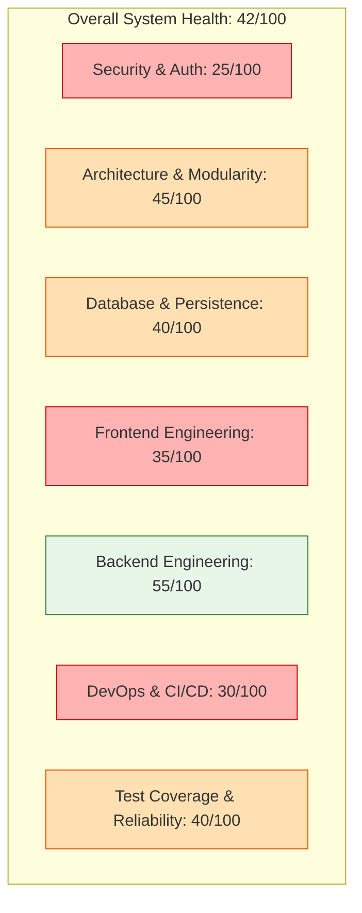

# Executive Summary: Technical Architecture & Production Readiness Audit

**Project:** Hyper Track  
**Repository:** `d:\Project\hyper-track-starter\hyper-track`  
**Evaluation Role:** Principal Software Architect, Senior Full-Stack Engineer, DevOps & SecOps Lead  
**Audit Date:** November 2026  
**Status:** **NOT PRODUCTION READY (BLOCKED BY CRITICAL SECURITY & DATA INTEGRITY RISKS)**  

---

## 1. Project Overview & Business Mission

Hyper Track is an integrated cross-platform personal productivity and habit-tracking system. Its design couples day-to-day task execution (tasks, subtasks, projects, and deadlines) with behavioral habit formation (daily/weekly schedules, streaks, and frequency tracking), outcome-based goals (milestones and target dates), focus management (Pomodoro-style timers), and gamified habituation (an XP ledger, leveling engine, streak multipliers, and achievements).

The application is architectured as a multi-workspace monorepo containing:
- **`apps/mobile`**: An Expo SDK 58 / React Native 0.88 cross-platform client targeting Android, iOS, and Web, equipped with Expo Router, Expo SQLite, and local caching.
- **`apps/api`**: A Node.js / Express 5 REST API written in TypeScript, backed by MongoDB / Mongoose 8 and JWT-based authentication.
- **`packages/shared`**: A shared TypeScript type definitions library providing core DTOs across the monorepo boundaries.

---

## 2. Executive Technical Assessment

The codebase exhibits thoughtful user experience design and well-engineered standalone algorithmic routines (such as timezone-aware local day calculations, DST gap resolution, and monotonic square-root level curves). However, the system currently represents an **intermediate development prototype** that has evolved organically without comprehensive integration boundaries. 

The application is **unfit for production deployment** in its present state due to critical security disclosures, fundamental data-integrity bugs in persistence models, an architectural bottleneck in offline synchronization, and an unstable "God-component" frontend state architecture.



---

## 3. Major Strengths

1. **Robust Date & Timezone Algorithmic Core:**
   The codebase recognizes that habit tracking and calendar deadlines are fundamentally timezone-dependent. `apps/api/src/services/dateMetrics.ts` implements iterative UTC-to-local approximation algorithms to handle daylight saving time (DST) shifts, 23- and 25-hour transition days, and wall-clock preservation across recurrences.
2. **Defensive Input Validation:**
   Both the API boundary (`apps/api/src/routes/*.ts`) and mobile offline transformation engine use strict Zod schemas with regex validators for date formats (`YYYY-MM-DD`), ISO datetime strings, and MongoDB ObjectIds.
3. **Structured Design System Tokens:**
   `apps/mobile/src/theme/theme.tsx` establishes a coherent semantic token architecture (`spacing`, `radii`, `palettes`, `fontSizes`) that cleanly maps between dark and light modes, avoiding magic numbers in newer UI components.
4. **Authoritative Ledger Principles:**
   XP transactions and gamification progression are anchored to an append-only transaction ledger (`XPTransaction`), preventing client-side fabrication of rewards during offline usage.

---

## 4. Critical Production Blockers (P0 Risks)

| Finding ID | Domain | File Location | Severity | Executive Impact |
| :--- | :--- | :--- | :--- | :--- |
| **SEC-01** | Security | `apps/api/.env`, `apps/api/.env.example` | **CRITICAL** | Production MongoDB Atlas credentials with plain-text user/password and the production `JWT_SECRET` are hardcoded in the repository and committed in `.env.example`. Complete database takeover and token forgery risk. |
| **DATA-01** | Database / Logic | `apps/api/src/models/HabitCompletion.ts:14` | **CRITICAL** | Unique compound index on `{ user: 1, habit: 1, localDate: 1 }` lacks a partial filter. If a user completes a habit, unchecks it (setting `reversedAt`), and checks it off again on the same day, MongoDB throws error 11000. |
| **ERR-01** | Error Handling | `apps/api/src/middleware/errors.ts:22-25` | **HIGH** | The global error handler maps *any* MongoDB error code 11000 to `409: "An account with this email already exists"`. When DATA-01 triggers, the user is told their habit cannot be checked because their email exists. |
| **SYNC-01** | Offline Outbox | `apps/mobile/src/lib/api.ts:50-53` | **CRITICAL** | Strict FIFO outbox replay permanently blocks the entire synchronization queue upon encountering a 4xx error (e.g., validation error, 409 conflict). No poison-pill eviction or dead-letter queue exists. |
| **DOS-01** | Security / Infra | `apps/api/src/server.ts:17` & `auth.routes.ts:67` | **HIGH** | Global auth rate limiter (30 req / 15 min) wraps `/api/auth/me`. Because mobile calls `/me` on launch and refresh, active users sharing a NAT/Wi-Fi IP address suffer complete denial of service. |
| **PERF-01** | Performance | `apps/mobile/src/components/HabitsScreen.tsx:54-60` | **HIGH** | Viewing the Habits screen fires `N` parallel HTTP requests (one `/analytics` call per habit). For 15 habits, this causes 15 simultaneous HTTP requests and 75 MongoDB database queries. |
| **PERF-02** | Frontend Arch | `apps/mobile/app/index.tsx:74-513` | **HIGH** | 524-line "God Component" holding 35+ React state hooks. Any task toggle triggers 7 to 10 parallel HTTP requests (`loadData`), re-rendering the entire app on every keystroke. |

---

## 5. Engineering Maturity Breakdown

```
Component               Maturity Level    Grade    Readiness Assessment
-------------------------------------------------------------------------
Architecture & Patterns  Intermediate      C-       Monorepo structure is clean, but mobile UI lacks state boundaries.
Backend Engineering      Proficient        B-       Good schemas and pure functions; lacks DB transactions and caching.
Frontend Engineering     Draft / Prototype D+       Severe state centralization, prop drilling, and re-render loops.
Database Design          Intermediate      C        Good relational models; broken uniqueness constraints and N+1 queries.
Application Security     Vulnerable        F        Hardcoded live database credentials; missing route rate limiting.
DevOps & CI/CD           Minimal           D        No test script at root, mobile tests omitted from CI, no CD pipeline.
Testing & QA             Low / Mock-Heavy  C-       Tests rely on mocked Mongoose methods; 0 integration/database tests.
```

---

## 6. Strategic Production Readiness Verdict

**Verdict: CONDITIONAL REJECTION**

Hyper Track demonstrates high-potential product mechanics and excellent UI aesthetics, but it cannot be deployed to real users without immediate remediation of the P0 security vulnerabilities and outbox deadlocks. 

Before launching an MVP to external beta users:
1. **Week 1:** Revoke and rotate all database credentials, remove live credentials from `.env.example`, fix the `HabitCompletion` index, and isolate the global error handler.
2. **Week 2:** Fix the offline outbox poison-pill deadlock, remove `/api/auth/me` from the registration/login rate limiter, and introduce batch analytics endpoints to eliminate the N+1 network storm.
3. **Week 3:** Refactor `apps/mobile/app/index.tsx` into domain React contexts (Auth, Tasks, Habits, Projects) and remove the full-database reload (`loadData`) on every item toggle.
4. **Week 4:** Add containerization (Dockerfile), set up a staging MongoDB instance, and establish real integration tests running on GitHub Actions.

