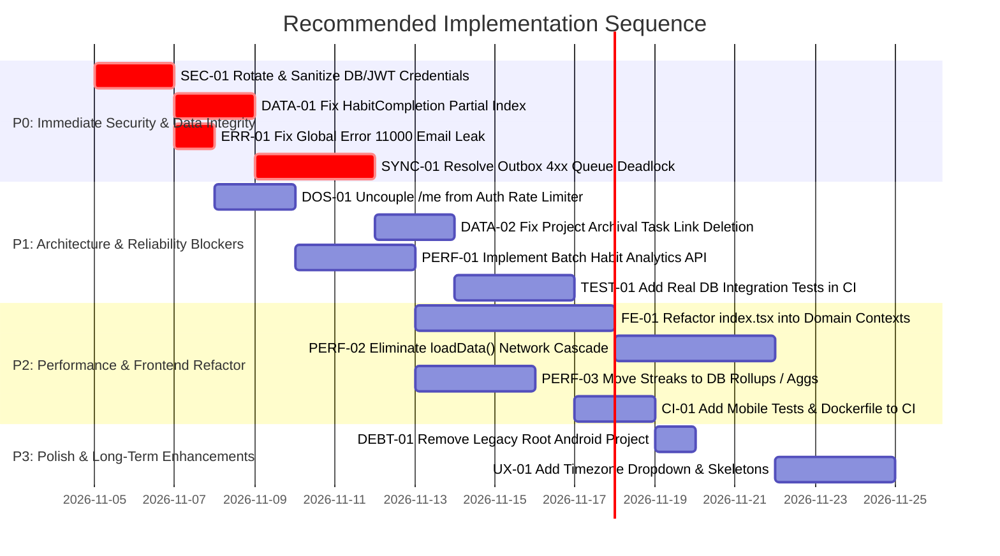

# Master Engineering Improvement Roadmap

**Document:** `PROJECT_ANALYSIS/MASTER_IMPROVEMENT_ROADMAP.md`  
**Target:** Engineering Backlog for Hyper Track Production Release  
**Auditor:** Principal Software Architect, Technical Lead & Engineering Director  

---

## 1. Roadmap Prioritization Framework

Tasks are categorized using industry-standard engineering severity tiers:
- **P0 — Critical Blocker:** Security exploits, data corruption/loss, permanent deadlocks, broken core user flows.
- **P1 — High Priority:** Major architectural liabilities, denial of service risks, production deployment blockers.
- **P2 — Medium Priority:** Performance bottlenecks, state refactoring, testing coverage, UX friction.
- **P3 — Low Priority / Polish:** Code cleanup, minor styling refinements, telemetry, documentation.

---

## 2. P0 — Critical Priority (Immediate Action Required)

### Task P0-01: Revoke, Rotate, and Sanitize Database & JWT Credentials
- **Task ID:** `SEC-01`
- **Problem:** Real production MongoDB Atlas credentials with plain-text password and live `JWT_SECRET` are committed in `apps/api/.env` and `apps/api/.env.example`.
- **Proposed Solution:**
  1. Rotate database password in MongoDB Atlas and restrict IP access.
  2. Generate new 64-byte random string for `JWT_SECRET`.
  3. Replace `apps/api/.env.example` with sanitized placeholders.
  4. Ensure `apps/api/.env` is ignored by git and remove sensitive commits from history using `git-filter-repo`.
- **Affected Files:** `apps/api/.env`, `apps/api/.env.example`, `.gitignore`
- **Dependencies:** None.
- **Priority:** **P0**
- **Estimated Complexity:** Small (1 day)
- **Expected Outcome:** Database cluster is secured against unauthorized external access.
- **Acceptance Criteria:**
  - [ ] MongoDB Atlas logs show old credentials rejected.
  - [ ] `.env.example` contains zero live credentials.
  - [ ] Fresh git clone contains no sensitive keys.

---

### Task P0-02: Fix HabitCompletion Index to Allow Re-Checkins After Undo
- **Task ID:** `DATA-01`
- **Problem:** Unique index `{ user: 1, habit: 1, localDate: 1 }` on `HabitCompletion` lacks a partial filter. If a user unchecks a habit (setting `reversedAt`) and checks it again on the same day, MongoDB throws Error 11000.
- **Proposed Solution:**
  Update index definition in `apps/api/src/models/HabitCompletion.ts` to include `partialFilterExpression: { reversedAt: null }`. Rebuild the index in MongoDB.
- **Affected Files:** `apps/api/src/models/HabitCompletion.ts:14`
- **Dependencies:** P0-01
- **Priority:** **P0**
- **Estimated Complexity:** Small (0.5 days)
- **Expected Outcome:** Users can freely check off, undo, and re-check habits multiple times per day without errors.
- **Acceptance Criteria:**
  - [ ] User can check in habit on date D.
  - [ ] User can undo check in on date D.
  - [ ] User can check in habit on date D again successfully.
  - [ ] Verified with automated integration test.

---

### Task P0-03: Isolate Global Error 11000 Handler from Non-User Models
- **Task ID:** `ERR-01`
- **Problem:** In `apps/api/src/middleware/errors.ts:22-25`, any duplicate key error (code 11000) returns `409: "An account with this email already exists"`.
- **Proposed Solution:**
  Inspect `error.keyPattern`. Return email conflict error *only* if `error.keyPattern.email` exists. For all other collisions, return appropriate duplicate entity messages.
- **Affected Files:** `apps/api/src/middleware/errors.ts:22-25`
- **Dependencies:** None.
- **Priority:** **P0**
- **Estimated Complexity:** Small (0.5 days)
- **Expected Outcome:** Meaningful error messages for document uniqueness conflicts.
- **Acceptance Criteria:**
  - [ ] Duplicate user registration returns 409 email exists.
  - [ ] Duplicate task clientMutationId returns 409 with duplicate mutation detail.

---

### Task P0-04: Resolve Outbox 4xx Unrecoverable Queue Deadlock
- **Task ID:** `SYNC-01`
- **Problem:** In `apps/mobile/src/lib/api.ts:50-53`, any HTTP error during outbox replay (including 400 Bad Request and 409 Conflict) triggers `break;`. Because FIFO is enforced, a bad mutation permanently blocks the entire synchronization queue.
- **Proposed Solution:**
  Distinguish between transient (5xx, network offline) and permanent (4xx client validation) errors. For permanent 4xx errors, move the item to a Dead-Letter Queue (`status: 'rejected'`) or acknowledge it with a local notification, unblocking subsequent mutations.
- **Affected Files:** `apps/mobile/src/lib/api.ts:45-64`, `apps/mobile/src/database/localStore.native.ts:171-185`
- **Dependencies:** None.
- **Priority:** **P0**
- **Estimated Complexity:** Medium (2 days)
- **Expected Outcome:** Sync queue never deadlocks on bad mutations.
- **Acceptance Criteria:**
  - [ ] A 400 Bad Request mutation is quarantined and logged.
  - [ ] Subsequent queued mutations proceed to sync immediately.

---

## 3. P1 — High Priority (Architecture & Production Blockers)

### Task P1-01: Decouple `/api/auth/me` from Brute-Force Rate Limiting
- **Task ID:** `DOS-01`
- **Problem:** In `apps/api/src/server.ts:17`, a 30 req / 15 min rate limiter mounted on `/api/auth` blocks legitimate users calling `/api/auth/me` during normal navigation.
- **Proposed Solution:**
  Apply strict rate limits exclusively to `/api/auth/login` and `/api/auth/register`. Remove `/api/auth/me` from IP-based login throttling.
- **Affected Files:** `apps/api/src/server.ts:17`, `apps/api/src/routes/auth.routes.ts`
- **Dependencies:** None.
- **Priority:** **P1**
- **Estimated Complexity:** Small (0.5 days)
- **Acceptance Criteria:** User can reload profile 50 times in 15 minutes without receiving HTTP 429.

---

### Task P1-02: Prevent Permanent Task Link Deletion on Project Archive
- **Task ID:** `DATA-02`
- **Problem:** In `apps/api/src/routes/projects.routes.ts:49`, archiving a project sets `project: null` on all tasks, destroying project task history upon unarchiving.
- **Proposed Solution:**
  Leave `project` reference on tasks intact. When querying active tasks, filter projects by `archivedAt: null` or check project status dynamically.
- **Affected Files:** `apps/api/src/routes/projects.routes.ts:47-51`
- **Dependencies:** None.
- **Priority:** **P1**
- **Estimated Complexity:** Small (1 day)
- **Acceptance Criteria:** Archiving and subsequently unarchiving a project preserves all associated tasks.

---

### Task P1-03: Implement Batch Habit Analytics Endpoint
- **Task ID:** `PERF-01`
- **Problem:** In `apps/mobile/src/components/HabitsScreen.tsx:54-61`, the client issues N parallel requests (1 per habit), causing up to 100 MongoDB lookups per screen view.
- **Proposed Solution:**
  Add `GET /api/habits/summary` endpoint on the server returning streak, completion count, and percentage for all user habits in a single aggregation.
- **Affected Files:** `apps/api/src/routes/habits.routes.ts`, `apps/mobile/src/components/HabitsScreen.tsx:50-65`
- **Dependencies:** None.
- **Priority:** **P1**
- **Estimated Complexity:** Medium (2 days)
- **Acceptance Criteria:** Opening Habits screen issues exactly 1 network request for analytics.

---

### Task P1-04: Add Real Database Integration Tests to CI
- **Task ID:** `TEST-01`
- **Problem:** API tests mock all Mongoose calls in memory. No tests run against real MongoDB instances, allowing schema and index bugs to escape into production.
- **Proposed Solution:**
  Introduce `mongodb-memory-server` and `supertest` in `apps/api/test/`. Add integration tests covering authentication, habit check-in/undo, and task creation.
- **Affected Files:** `apps/api/package.json`, `apps/api/test/integration/`
- **Dependencies:** P0-02
- **Priority:** **P1**
- **Estimated Complexity:** Medium (3 days)
- **Acceptance Criteria:** CI executes integration tests against real in-memory MongoDB engine.

---

## 4. P2 — Medium Priority (Performance, Code Quality & DevOps)

| Task ID | Component | Summary | Affected Files | Complexity |
| :--- | :--- | :--- | :--- | :---: |
| **FE-01** | Frontend | Refactor `HomeScreen` into domain React contexts (`AuthContext`, `TaskContext`, `HabitContext`). | `apps/mobile/app/index.tsx`, `apps/mobile/src/context/` | Large (4 days) |
| **PERF-02** | Frontend | Eliminate `loadData()` cascade; update local state optimistically using mutation responses. | `apps/mobile/app/index.tsx:132-175` | Medium (3 days) |
| **PERF-03** | Backend | Move streak calculations from in-memory arrays to incremental database rollups. | `apps/api/src/routes/gamification.routes.ts:18-42` | Medium (2 days) |
| **CI-01** | DevOps | Add `npm test -w @hyper-track/mobile` and `npm run build -w @hyper-track/api` to GitHub Actions. | `.github/workflows/ci.yml` | Small (0.5 days) |
| **CI-02** | DevOps | Create multi-stage `Dockerfile` and `docker-compose.yml` for local API + MongoDB testing. | `Dockerfile`, `docker-compose.yml` | Small (1 day) |
| **SEC-05** | Auth | Add stateless access token JTI validation / reduce access token expiry to 15 minutes. | `apps/api/src/routes/auth.routes.ts:20` | Small (1 day) |

---

## 5. P3 — Low Priority (Polish, Cleanup & Long-Term)

| Task ID | Component | Summary | Affected Files | Complexity |
| :--- | :--- | :--- | :--- | :---: |
| **DEBT-01** | Clean | Archive and remove legacy root `android/` directory to eliminate repository bloat. | `android/` | Small (0.5 days) |
| **UX-01** | Mobile UI | Replace plain text timezone input with searchable IANA timezone modal picker. | `apps/mobile/app/index.tsx:507` | Small (1 day) |
| **UX-02** | Mobile UI | Add animated skeleton loaders for dashboard metrics during initial cache hydration. | `apps/mobile/src/components/Dashboard.tsx` | Medium (2 days) |
| **OBS-01** | Observability | Replace raw `console.log` with structured JSON logger (`pino`) and add Sentry error monitoring. | `apps/api/src/server.ts`, `apps/mobile/app/_layout.tsx`| Medium (2 days) |

---

## 6. Quick Wins (High Impact, Under 4 Hours Each)

1. **Fix Habit Completion Partial Index (`DATA-01`):** 1-line change in `HabitCompletion.ts:14` resolves the habit check-in/undo error immediately.
2. **Fix Error 11000 Global Middleware Handler (`ERR-01`):** Check `keyPattern.email` before returning "email already exists" in `errors.ts:22`.
3. **Decouple `/api/auth/me` Rate Limiting (`DOS-01`):** Move rate limiter in `server.ts:17` directly onto `/login` and `/register` routes.
4. **Add Mobile Tests & Root Test Script to CI (`CI-01`):** Update `package.json` and `.github/workflows/ci.yml` in 15 minutes to prevent untested mobile regressions.

---

## 7. Change Management & Architectural Risks

- **Index Rebuild Risk:** When changing `HabitCompletion` index to `{ partialFilterExpression: { reversedAt: null } }`, ensure the existing index is dropped and rebuilt gracefully in MongoDB Atlas without downtime.
- **Offline Cache Migration Risk:** When refactoring `apps/mobile/app/index.tsx` into domain contexts, ensure backward compatibility with existing SQLite tables so existing users on mobile devices do not lose offline pending mutations.

