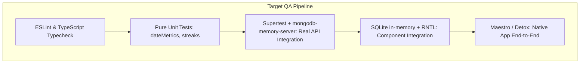

# Testing Infrastructure & System Reliability Audit

**Document:** `PROJECT_ANALYSIS/TESTING_AND_RELIABILITY.md`  
**Target:** Monorepo Test Suites (`apps/api`, `apps/mobile`)  
**Auditor:** Quality Engineering Director & Reliability Lead  

---

## 1. Existing Test Architecture & Coverage Summary

| Suite / Workspace | Runner | Test Files | Total Tests | Mocking Nature | Real DB Tested? | CI Integration |
| :--- | :--- | :---: | :---: | :--- | :---: | :---: |
| **API (`apps/api`)** | Node.js Test Runner via `tsx` | 5 | 28 | **Heavy.** Mongoose static methods manually stubbed. | **No (0%)** | Yes (`test:api`) |
| **Mobile (`apps/mobile`)** | Node.js Test Runner via `tsx` | 4 | 12 | **None.** Pure unit functions & regexes. | **No (0%)** | **No (Omitted)** |
| **Root Workspace** | None | 0 | 0 | N/A | N/A | Missing `npm test` |

```
Test Pyramid Evaluation:
       /\
      /  \      E2E Tests: 0% (Absent)
     /    \
    /      \    Integration Tests: 0% (No real DB/HTTP tests)
   /        \
  /__________\  Unit Tests: 100% (Mock-heavy route & logic tests)
```

---

## 2. In-Depth Analysis of Existing Tests

### 2.1 Backend Tests (`apps/api/test/`)
The API suite contains 28 passing tests covering:
- Date calculation edge cases (`dateMetrics.test.ts` via `phase-features.test.ts`): Tests 23/25 hour DST days, leap years, and local day boundaries.
- Habit streak algorithms (`habitStreaks.test.ts`): Tests consecutive-day streak logic and schedule changes.
- Gamification service ownership (`gamification.test.ts`): Tests that `awardXp` correctly passes `user` instead of `userId`.
- Route security mocks (`routes.test.ts`): Tests route-level rejection when `Authorization` header is missing.

#### Critical Vulnerability of the Backend Test Approach:
The route tests do **not** run against an Express HTTP server or a real database. Instead, `routes.test.ts:51-67` manually inspects the Express router's internal layer stack:
```ts
const layer = (router as { stack: RouterLayer[] }).stack.find(
  (candidate) => candidate.route?.path === path && candidate.route.methods[method.toLowerCase()]
);
const handler = layer.route.stack.at(-1)!.handle;
await handler(req, res, (error) => { ... });
```
Furthermore, Mongoose static methods are overridden in memory:
```ts
Task.create = (async () => { writes += 1; return {}; }) as typeof Task.create;
```
**Why this creates a false sense of security:**
1. **Index Violations Undetected:** The `HabitCompletion` unique index failure (**DATA-01**) was never caught because tests mock `HabitCompletion.create` rather than running against MongoDB.
2. **Global Error Handler Misalignment:** The Error 11000 duplicate email bug (**ERR-01**) passed through CI because real database duplicate key errors are never simulated.
3. **Transaction Failures Untested:** Race conditions, concurrent updates, and partial write failures cannot be tested with synchronous in-memory stubs.

---

### 2.2 Mobile Tests (`apps/mobile/test/`)
The mobile test suite contains 12 unit tests:
1. `calendar-event-keys.test.ts`: Verifies stable deduplication keys for calendar completion records.
2. `offline-mutations.test.ts`: Verifies offline snapshot transformation logic for task/habit optimistic updates.
3. `queue-policy.test.ts`: Verifies that `readyQueuePrefix` enforces FIFO dependency ordering.
4. `sqlite-schema.test.ts`: Inspects the SQL DDL strings with regexes (`assert.match(sql, /CREATE TABLE IF NOT EXISTS users/)`).

#### Critical Coverage Gaps in Mobile:
1. **Zero UI / Component Tests:** There are no tests using `@testing-library/react-native`. Screens (`Dashboard`, `TaskManagementScreen`, `HabitsScreen`) have never been tested for rendering, accessibility, or user interaction.
2. **Zero SQLite Runtime Verification:** `sqlite-schema.test.ts` merely verifies that SQL strings contain certain keywords. It does **not** initialize an actual SQLite database or execute the DDL statements against an engine.
3. **CI Pipeline Omission:** The root `.github/workflows/ci.yml` does **not** run `npm test -w @hyper-track/mobile`. Any regression introduced into the mobile tests will pass CI undetected!

---

## 3. Critical Workflows Currently Lacking Any Test Coverage

1. **User Registration, Login & Token Refresh Workflow:**
   - Registration with duplicate email (verifying HTTP 409).
   - Login with invalid password (verifying HTTP 401).
   - Refresh token rotation (verifying single-use token invalidation and race conditions).
2. **Task Creation with Project & Subtask Relational Links:**
   - Assigning a task to a non-existent project (verifying HTTP 400).
   - Assigning a subtask to another user's task (IDOR authorization check).
   - Creating circular subtask relationships.
3. **Habit Completion Check-in / Undo Lifecycle:**
   - Check-in -> Undo -> Re-check-in on the same date (verifying **DATA-01**).
4. **Offline Queue Sync & Dead-Letter Handling:**
   - Replaying a valid mutation when reconnecting to network.
   - Behavior when a queued mutation receives HTTP 400 vs HTTP 500.
5. **Data Export Correctness:**
   - Exporting JSON and CSV formats and validating schema structure.

---

## 4. Recommended Target Testing Architecture



### Practical Implementation Steps:
1. **Adopt `mongodb-memory-server` and `supertest` for API Tests:**
   Replace internal router stack traversal with standard HTTP testing against an in-memory MongoDB instance:
   ```ts
   import request from "supertest";
   import { MongoMemoryServer } from "mongodb-memory-server";
   // Run real HTTP requests against Express app connected to real in-memory MongoDB
   const res = await request(app).post("/api/tasks").set("Authorization", `Bearer ${token}`).send({ title: "Real task" });
   assert.equal(res.status, 201);
   ```
2. **Add Mobile Tests to CI Pipeline:**
   Update `.github/workflows/ci.yml` to include:
   ```yaml
   - run: npm run test -w @hyper-track/mobile
   ```
3. **Add Root `npm test` Script:**
   Add `"test": "npm run test:api && npm test -w @hyper-track/mobile"` in root `package.json`.
4. **Implement Component Testing with React Native Testing Library:**
   Add smoke tests for `AppNavigation`, `Dashboard`, and `TaskManagementScreen`.

